<!-- readme-kind: app -->
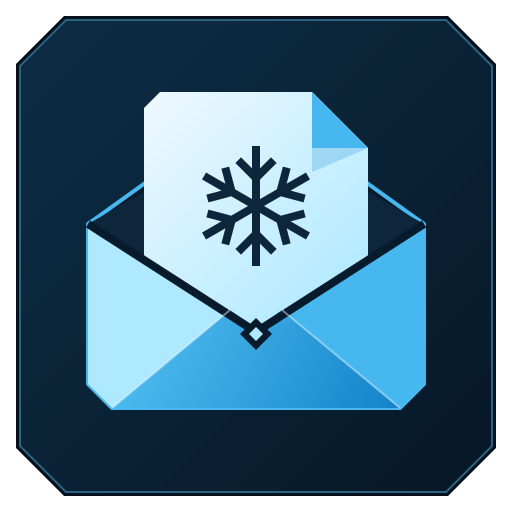

# Frostmail

[](https://github.com/frostyard/frostmail/actions/workflows/ci.yml)
[](https://awesomemygo.dev/apps/frostmail)

**A mail client that works like Apple Mail.app.**

Frostmail is a desktop mail client for Linux and Windows, for people who
want Mail.app's way of working without a GNOME or KDE look. It keeps your
mail, contacts, calendars and tasks in a daemon on your machine, which can
also serve a phone or a browser on your tailnet through
[lodge](https://github.com/frostyard/lodge).

**Status:** pre-release. The [roadmap](docs/plans/0002-roadmap.md) says what works and what comes next.

**Documentation:** [frostyard.org/docs/apps/frostmail](https://frostyard.org/docs/apps/frostmail/)

## What it does

- **Mail.** It syncs, reads, searches and sends generic IMAP, Gmail,
  iCloud and Outlook.com accounts, and it is the owner's daily mail client.
  [M4](docs/plans/0006-m4-daily-driver.md)
- **Contacts, calendars and tasks** over CardDAV, CalDAV, Google Tasks and
  Microsoft Graph: invitations answered from the reader, events and
  contacts edited in place, and a To-Do bar beside the inbox.
  [M4.5](docs/plans/0007-m4.5-people-calendar-tasks.md),
  [M5.5](docs/plans/0009-m5.5-edit-events-and-contacts.md)
- **Mail.app's tools:** rules, smart mailboxes, VIPs, Send Later and Remind
  Me. [M5](docs/plans/0008-m5-mail-app-parity.md)
- **maild** is a per-user Go daemon that owns sync, a SQLite cache with
  full-text search, and a JSON-RPC socket. [Overview](docs/design/overview.md)
- **The app** is a native Go app on NSGo and Frostyard's kit
  ([ADR-0063](docs/adr/0063-make-the-nsgo-client-the-only-client.md)). The
  earlier client, on MyGo and frostui, is still the Windows installer's
  program, and the Flatpak holds it for 1 more release.
  [Desktop design](docs/design/desktop.md)
- **mailctl** is a command-line client of the same socket.
- **Mail in lodge:** lodge serves a React web app of the same mail, built
  and in progress. [M8](docs/plans/0011-m8-mail-in-lodge.md)


| | |
| --- | --- |
| 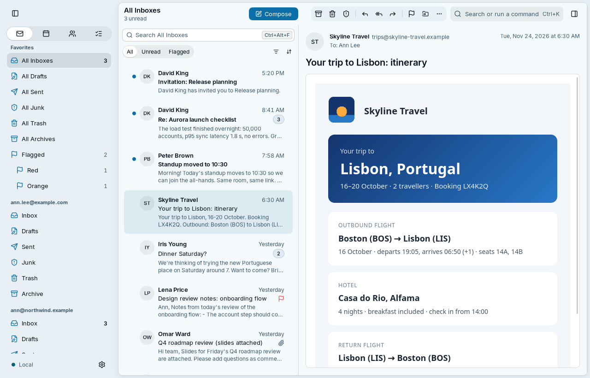 | 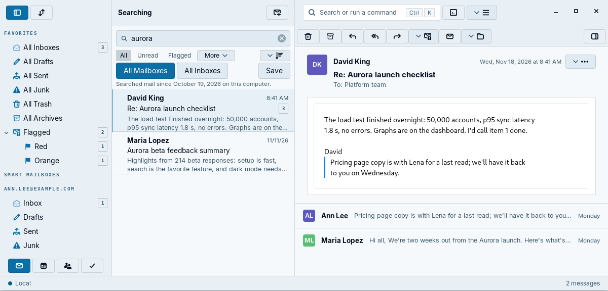 |
| 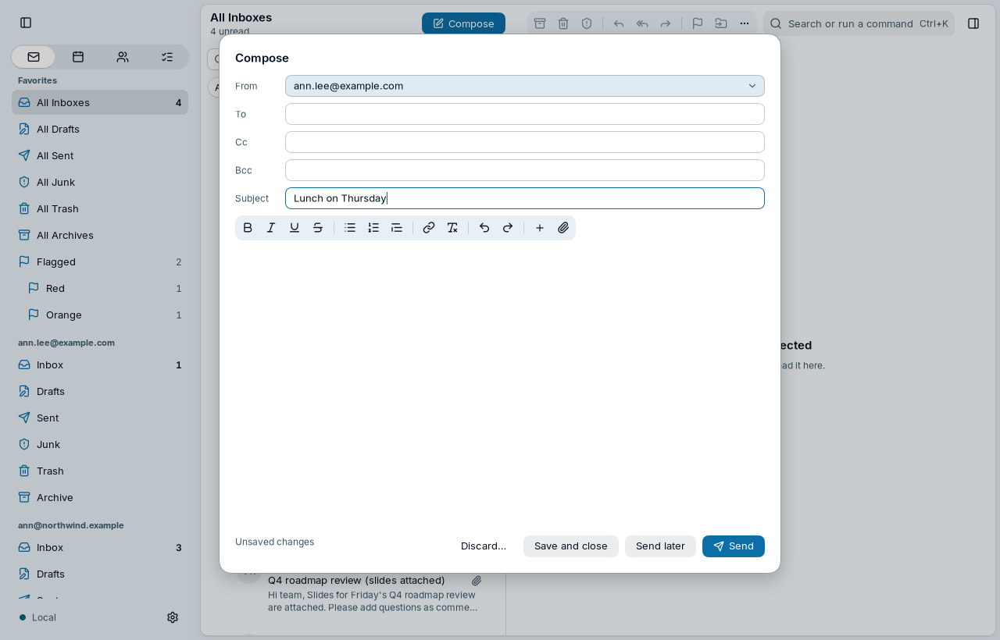 | 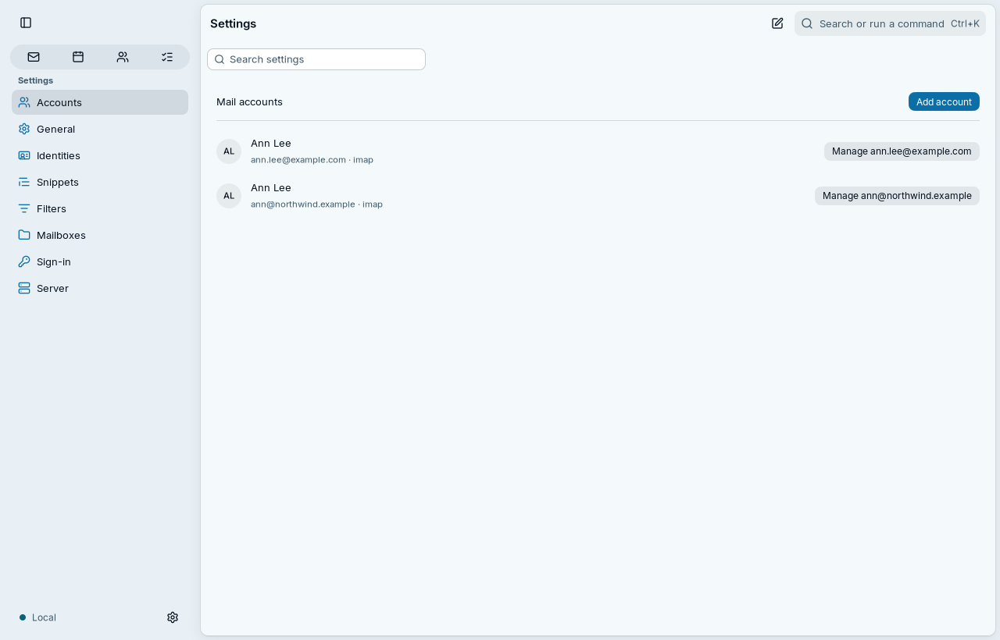 |
| 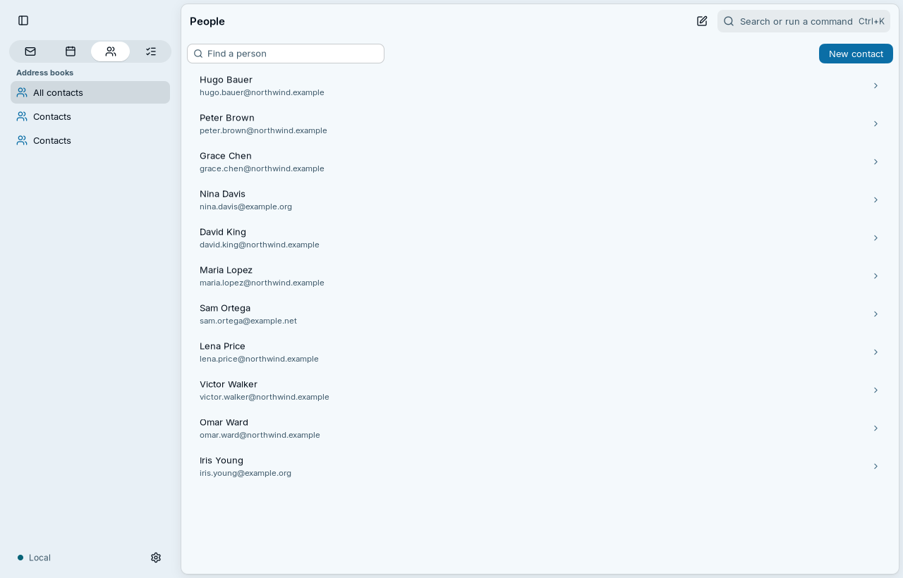 | 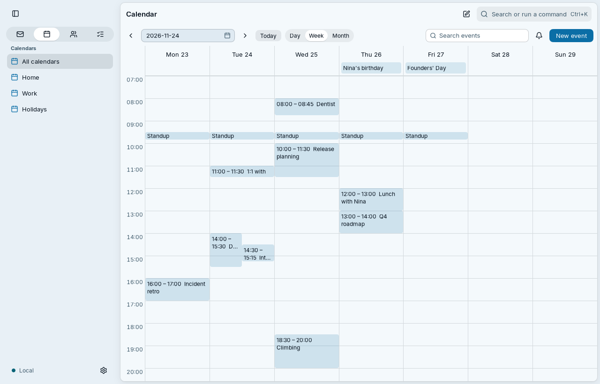 |
| 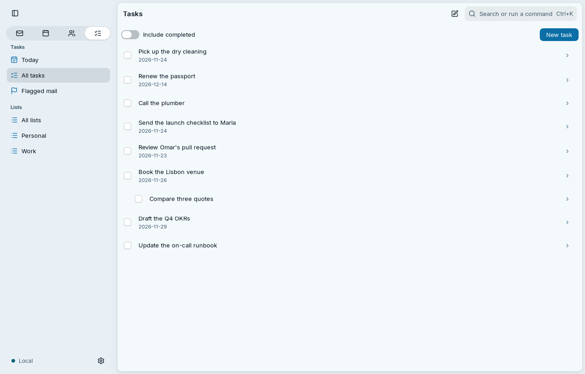 | 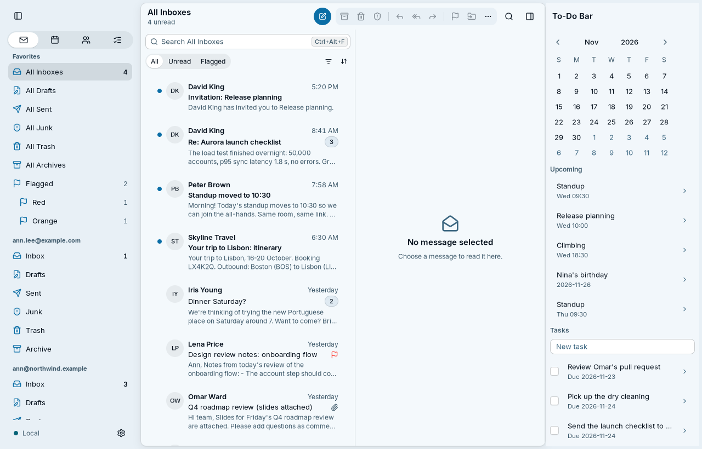 |
| 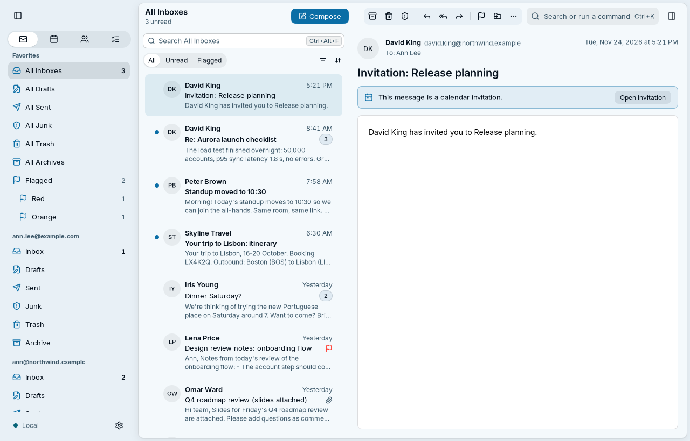 | 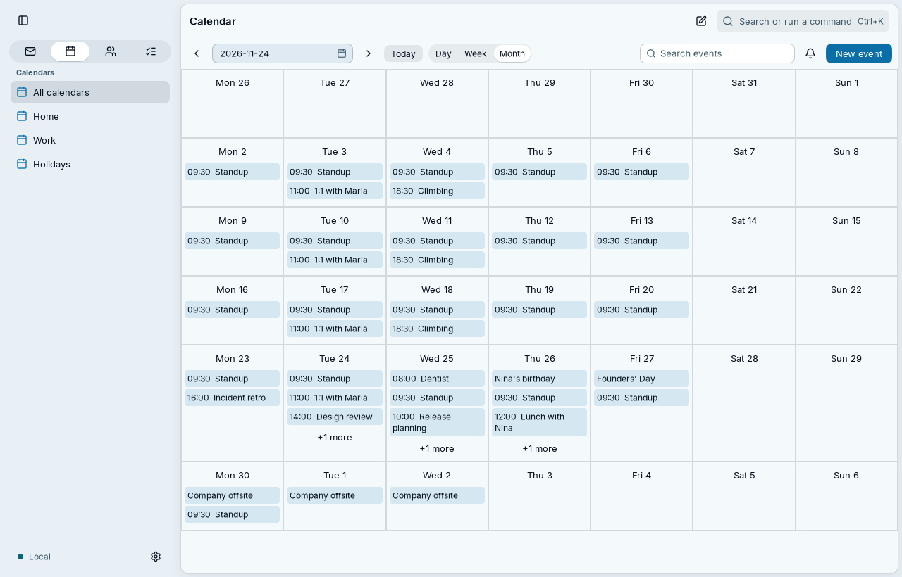 |

<sub>The screenshots show the desktop app on Linux, in Frostyard light and
once in the Frostyard theme, on made-up mail (`tools/uifixture/showcase`).
They are the app's own test suite's pictures
(`cmd/frostmail-nsgo/comparison/linux`).</sub>

## Install

Frostmail is on the [Frostyard Flatpak remote](https://github.com/frostyard/flatpak-index),
with its own maild and mailctl inside; it needs no lodge. Add the remote and
Flathub (for the runtime) once, for your user, then install Frostmail and
update it with `flatpak update`:

```sh
flatpak remote-add --user --if-not-exists frostyard https://frostyard.github.io/flatpak-index/frostyard.flatpakrepo
flatpak remote-add --user --if-not-exists flathub https://dl.flathub.org/repo/flathub.flatpakrepo
flatpak install --user frostyard org.frostyard.Frostmail
```

Other ways: each [release](https://github.com/frostyard/frostmail/releases)
has `frostyard-maild`'s .deb for lodge's host, and the
[guide](https://frostyard.org/docs/apps/frostmail/) covers the build from
source and Windows.

## Remove

```sh
flatpak uninstall --user org.frostyard.Frostmail
```

Your mail cache, settings and accounts stay in
`~/.var/app/org.frostyard.Frostmail/` unless you add `--delete-data`. The
accounts' passwords and tokens stay in the Secret Service, under the
application `org.frostyard.Frostmail`.

## Problem records

maild, mailctl and the app write their panics and a few coded errors (a
database that does not migrate, secrets that do not unseal, a sync that cannot
store what the server says, a message that cannot be parsed, the app losing
maild) to the local systemd journal. They send nothing and open no network
connection for it. On snosi images, chairlift can show these records, and it
sends nothing without the user's consent. Only release builds record; see
[ADR-0049](docs/adr/0049-record-problems-in-the-local-journal.md).

## Develop

Requirements: Go 1.27 and `mise install` (golangci-lint) on the host;
[nsl](https://github.com/frostyard/nsl) for the app toolchain; incus for the
test mail server.

```sh
nsl create frostmail --distro debian:13
nsl run -m frostmail --root bash dev/nsl/provision.sh "$(id -un)"
dev/incus/mailtest.sh up
make check          # host: generated files, vet, lint, unit tests
make engine-it      # integration tests against the test mail server
make ui-test        # nsl: typecheck and UI tests
make app-run        # nsl: maild plus the built app
```

`make help` lists every target. Architecture starts at
[docs/design/overview.md](docs/design/overview.md).

### Try the shared NSGo client

Linux, Windows and Lodge can run the same Go workspace against maild. Mail, drafts, rules, accounts, Calendar, People and Tasks use the existing database and RPC API. The Linux client connects to the local socket or the Lodge address in Frostmail’s server settings.

| Build | How to open it |
| --- | --- |
| Linux checkout | Run `make nsgo-build`, start maild, then run `build/frostmail-nsgo`. |
| Flatpak | It is the app the Flatpak opens. `flatpak run --env=FROSTMAIL_UI=mygo org.frostyard.Frostmail` opens the MyGo client, which the Flatpak holds for 1 more release. |
| Candidate Windows installer | Open `frostmail-nsgo.exe` from the Frostmail installation directory. |
| Lodge | Run `make nsgo-lodge-app` and use `build/nsgo-lodge/apps/mail` as the Mail app directory in a test Lodge. It uses the signed-in Lodge session. |

For a disposable local trial, `make nsgo-test` runs the workspace against generated mailboxes and a loopback SMTP server. The authenticated Firefox test and host-specific behavior are described in [the NSGo design decision](docs/adr/0061-share-the-mail-client-with-nsgo.md).

## Where to go next

- [AGENTS.md](AGENTS.md): the rules for agents and contributors.
- [docs/README.md](docs/README.md): the decisions, designs, specs and plans.
- [SECURITY.md](SECURITY.md): report a vulnerability privately.
- [LICENSE](LICENSE): MIT. `third_party/go-imap` is MIT, from
  emersion/go-imap, with the patches in its `FROSTMAIL-PATCHES.md`.
